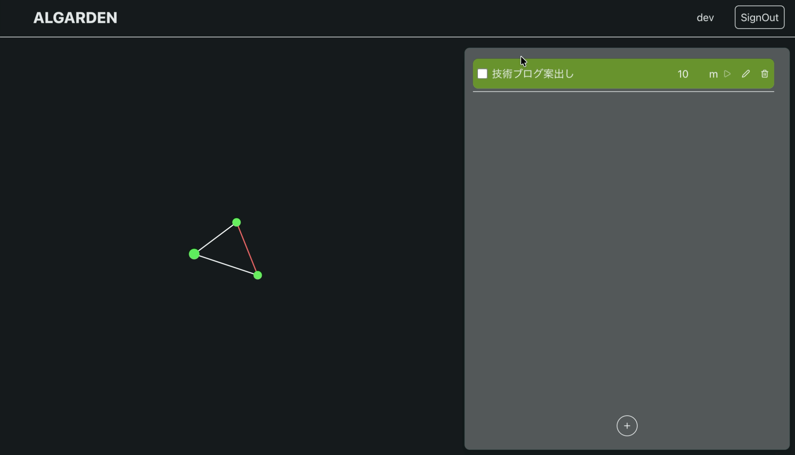
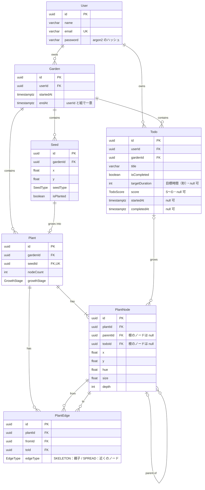

# ALGARDEN

Todoを完了すると、アルゴリズムに従ってノードネットワークを形成していくWebアプリです。 
現在スマホ対応はしていないため、PCにてご確認ください。

左の黒い背景が「庭」、右が「Todoリスト」です。 
Todo を1つ完了するたびに、庭に「ノードネットワーク」が形成されます。

## デモ

**https://algarden.vercel.app** にアクセスし、次のアカウントでサインインが可能です（登録は不要です）。

- メール：`demo@example.com`
- パスワード：`Demo.1234`

 

> [!NOTE]
>
> - 全員で同じアカウントを使います。タイマーが動いたままの Todo があると、新しい Todo を開始できません。 
> - そのときは、その Todo のチェックボックスにチェックを入れて完了してください。 
> - 庭は毎月1日 9:00（日本時間）に新しくなります。自動で育て直すため、その後の数十分は庭が空か、育っている途中な可能性があります。

 

## 技術スタック

| Category          | Technology Stack                                                                      |
| ----------------- | ------------------------------------------------------------------------------------- |
| Frontend          | TypeScript 5, React 19, Vite 8, React Router 7, TanStack Query 5, Tailwind CSS 4, Zod 4 |
| Backend           | TypeScript 5, NestJS 11, Prisma 7, Passport (JWT), argon2, class-validator, d3-force 2  |
| Database          | PostgreSQL 16                                                                         |
| Infrastructure    | Vercel (web / api), Neon                                                              |
| CI/CD             | GitHub Actions, Vercel (Git integration)                                              |
| Testing           | Jest 30                                                                               |
| Tools             | Insomnia (API), draw.io (diagrams)                                                    |
| Environment setup | Docker (PostgreSQL), Node.js 24, Turborepo 2, npm workspaces                          |
| Linter / Formatter| ESLint, Prettier                                                                      |

## アーキテクチャ

## 機能

- サインアップ
- サインイン
- Todoリスト
  - 作成・編集・削除
  - 目標時間の設定
  - スコア判定
  - タイマー（同時稼働は1つまで）
- 庭
  - 庭の月次リセット
  - ノードネットワークを画面に収める自動フィット
- ノードネットワーク
  - ノード配置の計算
  - ノードの 成長・延焼 アルゴリズム

 

| タスク完了後、ノードが成長している画面 |
| :--- |
|  |
## ER 図

ノードネットワークは、点の表（PlantNode）と線の表（PlantEdge）に分けて保存しています。親子のつながりは、PlantNode の parentId にも持たせています。

ER 図を開く（主なカラムのみ。すべての定義は <a href="apps/api/prisma/schema.prisma">schema.prisma</a>）

