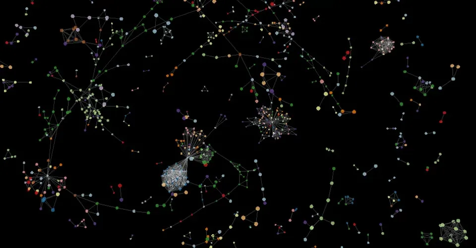
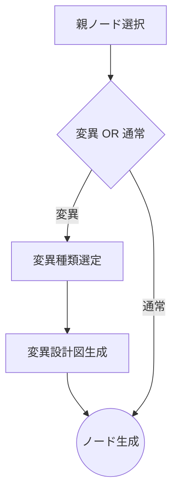
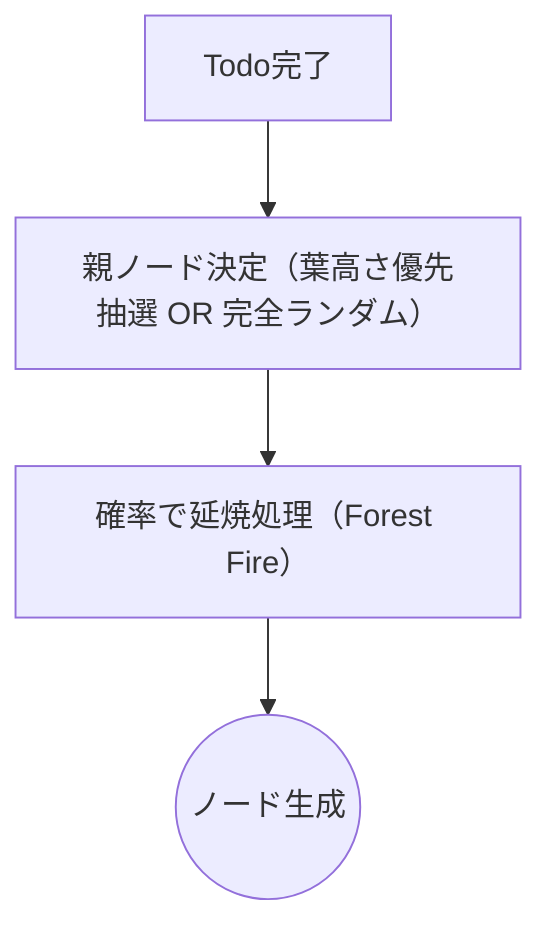
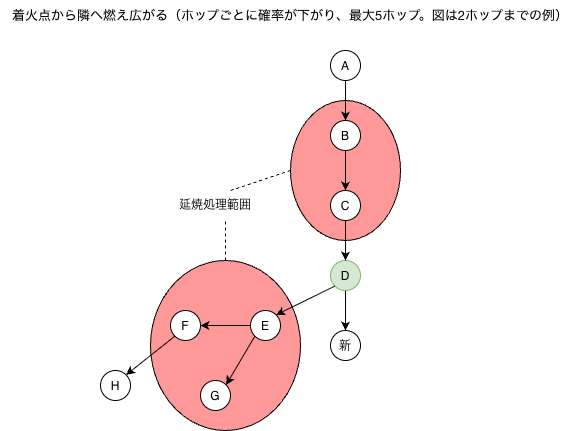
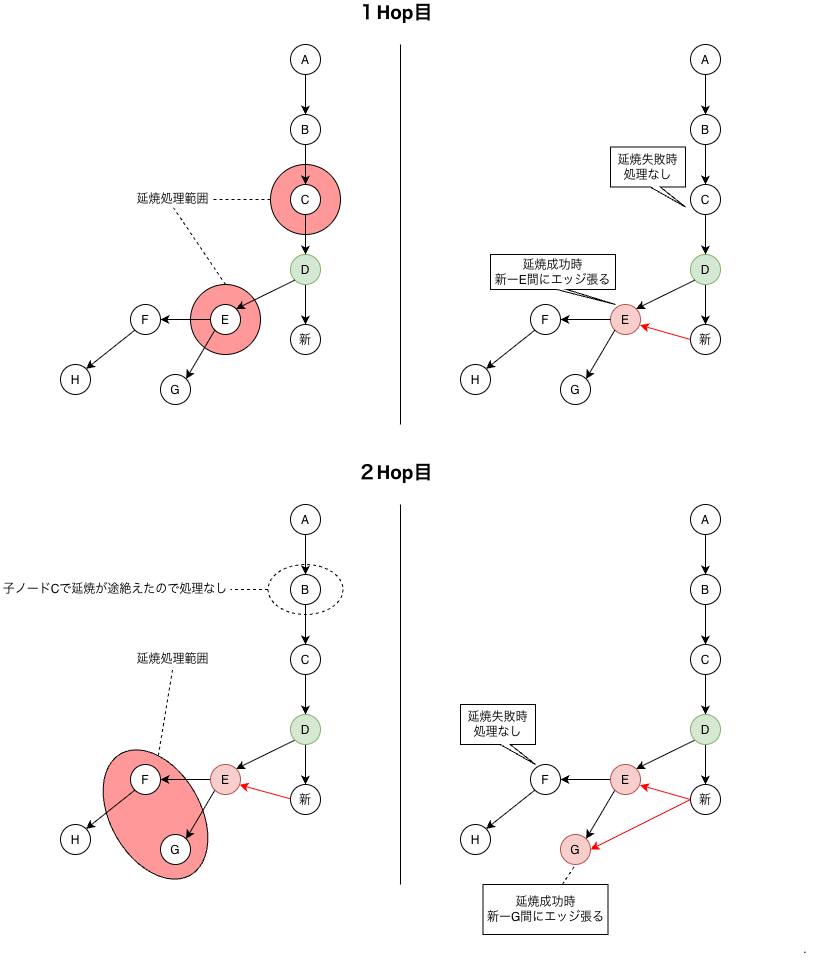

# 0004. 庭の成長に Forest Fire の延焼を入れる

- 状態：採用
- 決定日：2026-06-30

## 背景

（画像参考：https://github.com/vasturiano/3d-force-graph.git）

育てるネットワークのモデルを探していたときに、上の画像のネットワークの構造に出会い、良いと思った。そこで、この画像のようなネットワークを目指すことにした。

画像では、基本は蔓のようにエッジが伸びている。ただ、ところどころでノードが集まっていたり（以降「ノード集合群」）、集まりながら綺麗な図形になっていたり（以降「ノード図形集合群」）するように見える。見た目としては、宇宙に加えて、植物が種から育っていくようにも見えたので、この2つを軸に開発している。

画像のネットワークを作るアルゴリズムがなかったので、独自に作ることにした。最初は木構造を中心に考えた。木構造なら、ノードが1つの親ノードに収束するので、植物という考え方にも合う。ノード図形集合群は「変異」として、成長の途中で一定の確率で生まれるようにした。

これを「Tendril Algorithm」としてまとめた。

- 通常成長：既存のノードから、子の数で重みを付けた抽選で親を選び、ネットワークを広げていく。栄えている枝ほど育ちやすい（マタイ効果）。
- 変異：低い確率で起き、新しいノードに「設計図」として宿る。設計図は、その後の Todo の完了で少しずつ形になっていく。

その後、Tendril Algorithm には次の2つの問題があると分かった。

1. 変異は、MVP には重い機能だった（[0006](0006-postpone-mutation.md)）。
2. まばらにクラスターを作りたいのに、マタイ効果によって、1つの巨大なクラスターができることがある。

そこで、ノード集合群をマタイ効果で作るのではなく、ベースのアルゴリズムに組み込めないかを考えた。

## 検討した案

### BA モデル

- スケールフリーネットワークを作るモデルの代表格。次数（各ノードが持つエッジの数）が大きいノードほど、新しいノードとつながりやすい（優先的選択）。これは実質マタイ効果と同じで、その結果として、次数の分布がべき乗則に従う。

### 空間ネットワーク

- 網目が全体に均一に広がるので、採らなかった。
- ただ、ノード同士に物理的な距離があるという考え方によって、1つの巨大なハブができにくい。この考え方は取り入れることにした。

## 決定

新しいノードは、次の流れで作る。親ノードの決め方は [0005](0005-flash-point-height.md) に書く。

延焼（Forest Fire）を入れた理由は、次の2つ。

- 木構造では、各ノードが親を1つだけ選ぶので、閉路（ループ）が1つもできない。参考画像には閉路の束があり、変異だけでは足りない。Forest Fire なら、これまで作れなかった閉路を作れる。
- 延焼の範囲をホップ数で区切ることで、空間ネットワークの「1つの巨大なハブができにくい」という特徴を、別の方法で取り入れられる。

延焼処理の全体像

段階的な延焼処理

## 結果

- 【当初】：決めたときに見込んでいたこと
- 【年-月】：後から分かったこと（分かった時期）

### メリット

- 【当初】延焼の起きやすさと燃え広がりやすさの確率を変えるだけで、ノード集合群の数と濃さを調整できる。

### デメリット

- 【当初】ノードのつながりを、親子の1本では表せなくなった。延焼でできたエッジは PlantEdge テーブルに入れ、親子のエッジは parentId と PlantEdge の両方に持つ。
- 【2026-07】閉路ができるので、親からの角度と距離でノードの位置を決める方式が使えなくなった（[0007](0007-d3-force-coordinates.md)）。
