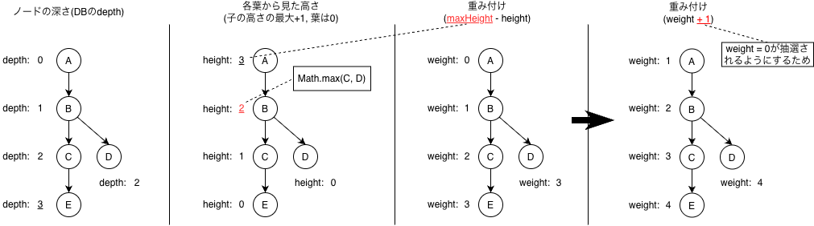

# 0005. 着火点は「葉からの高さ」で重みを付けて選ぶ

- 状態：採用
- 決定日：2026-06-30

## 背景

新しいノードは、親ノード（延焼の着火点）を決めてから、確率で延焼させて作る（[0004](0004-forest-fire.md)）。Tendril Algorithm では、子の数で重みを付けた抽選で、親を選んでいた（マタイ効果）。

## 検討した案

### 子の数で重みを付ける（Tendril Algorithm のまま）

- まばらにクラスターを作りたいのに、マタイ効果（子の数が多いほど選ばれやすい）によって、1つの巨大なクラスターができることがある。

### ルートからの深さで重みを付ける

- 一番深いノードばかりが選ばれ、一本道に伸びていく。

## 決定

子が4未満のノードを候補にし、次のどちらかで1つ選ぶ。

- 確率 `P_LEAF` で、葉高さ優先抽選をする。葉に近いノードほど選ばれやすい。
- 残りの確率で、候補から完全にランダムに選ぶ。伸びていない枝にも、芽を出させるためである。

葉高さ優先抽選の重みは、次のように付ける。

- 高さは、葉を 0 とし、親は「子の高さの最大 + 1」とする。
- 重みは「最大の高さ − 高さ」に 1 を足した値にする。1 を足すのは、重みが 0 になるノード（一番高いノード）も選ばれるようにするため。

## 結果

- 【当初】：決めたときに見込んでいたこと
- 【年-月】：後から分かったこと（分かった時期）

### メリット

- 【当初】葉はすべての枝にあるので、葉を優先しても、1本の枝だけが伸び続けることはない。内側のノードは選ばれにくいので、1つの巨大なクラスターにもならない。

### デメリット

- 【当初】葉を優先しすぎると、どのノードも子を1つずつしか持たない、細い鎖のような形になる。`P_LEAF` と重みの付け方で調整する。
